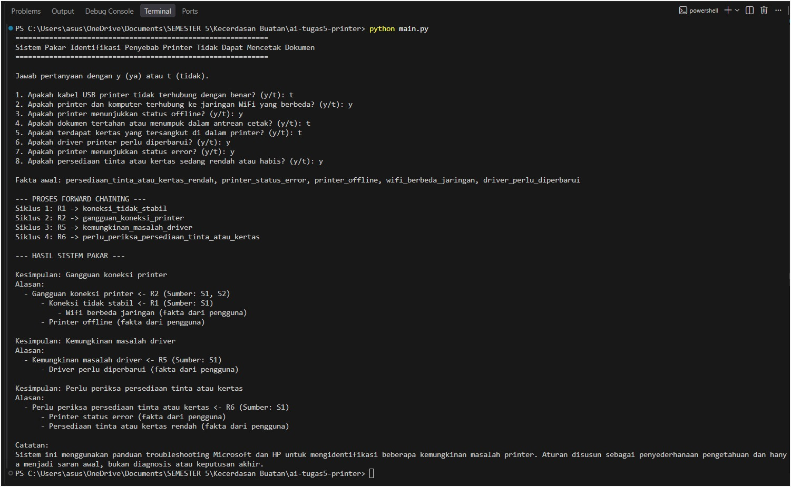
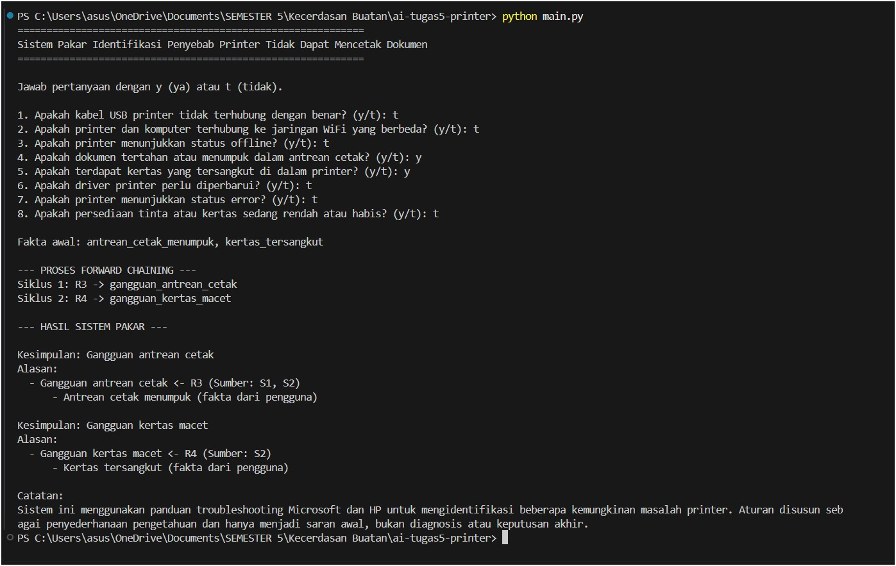
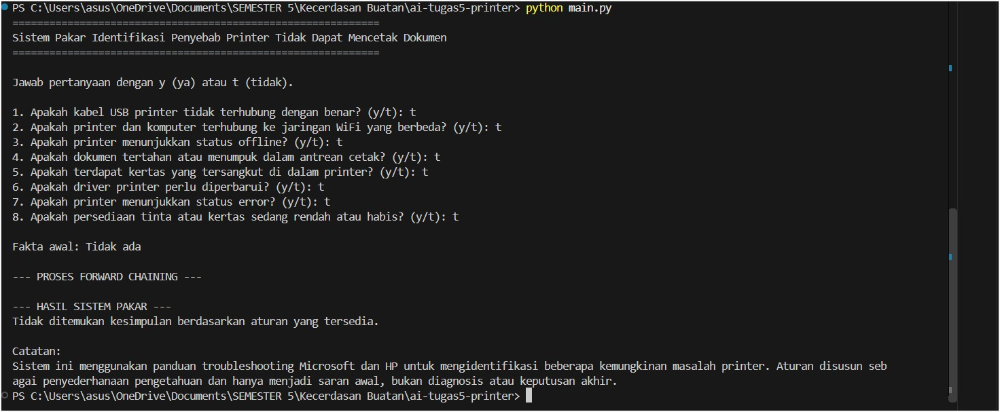

# Sistem Pakar Identifikasi Penyebab Printer Tidak Dapat Mencetak Dokumen

- **Nama:** Alya Rasyida Putri
- **NIM:** F1D02410002
- **Program Studi:** Teknik Informatika

## 1. Deskripsi Proyek

Sistem Pakar Identifikasi Penyebab Printer Tidak Dapat Mencetak Dokumen merupakan program sederhana berbasis Python yang digunakan untuk mengidentifikasi beberapa kemungkinan penyebab printer tidak dapat mencetak dokumen.

Sistem ini bekerja dengan mengajukan sejumlah pertanyaan kepada pengguna mengenai kondisi printer. Jawaban pengguna kemudian diproses menggunakan metode **Forward Chaining** berdasarkan aturan IF-THEN yang tersimpan dalam file `kb_printer.json`.

Hasil yang diberikan berupa kemungkinan gangguan printer beserta alasan dan aturan yang digunakan dalam proses penalaran.

Sistem ini hanya memberikan saran awal berdasarkan basis pengetahuan yang tersedia, bukan diagnosis atau keputusan akhir.

## 2. Teknologi yang Digunakan

- **Bahasa pemrograman:** Python
- **Versi Python:** 3.14.3
- **Format basis pengetahuan:** JSON
- **Metode inferensi:** Forward Chaining
- **Editor kode:** Visual Studio Code

## 3. Struktur Folder

```
ai-tugas5-printer/
│
├── main.py
├── kb_printer.json
├── README.md
│
└── screenshot/
    ├── pengujian-1.png
    ├── pengujian-2.png
    └── pengujian-3.png
```

## 4. Cara Menjalankan Program

Pastikan Python sudah terpasang pada komputer.

**Langkah 1.** Buka folder proyek menggunakan Visual Studio Code.

**Langkah 2.** Buka terminal melalui menu Terminal → New Terminal.

**Langkah 3.** Periksa versi Python dengan perintah:

```bash
python --version
```

**Langkah 4.** Jalankan program menggunakan perintah:

```bash
python main.py
```

**Langkah 5.** Jawab setiap pertanyaan dengan memasukkan:

- `y` untuk Ya.
- `t` untuk Tidak.

Setelah seluruh pertanyaan dijawab, sistem akan menjalankan proses Forward Chaining dan menampilkan hasil identifikasi beserta alasannya.

## 5. Sumber Pengetahuan

Basis pengetahuan dalam sistem ini disusun berdasarkan dua sumber dokumentasi resmi berikut.

**Sumber 1**

- Judul: Perbaiki masalah koneksi printer dan pencetakan di Windows
- Penerbit: Microsoft Support
- URL: https://support.microsoft.com/id-id/windows/hardware/printer/fix-printer-connection-and-printing-problems-in-windows
- Tanggal akses: 9 November 2026

**Sumber 2**

- Judul: HP printers – Cannot print
- Penerbit: HP Support
- URL: https://support.hp.com/gb-en/document/ish_14746154-14746200-16
- Tanggal akses: 9 November 2026

## 6. Basis Pengetahuan dan Aturan IF-THEN

Basis pengetahuan dalam sistem ini terdiri dari delapan fakta awal yang diperoleh melalui jawaban pengguna dan enam aturan IF-THEN untuk menghasilkan kesimpulan.

Berikut merupakan aturan yang diterapkan dalam sistem:

R1 – Identifikasi Koneksi Tidak Stabil
IF: Kabel USB tidak terhubung dengan benar ATAU printer dan komputer terhubung ke jaringan WiFi yang berbeda.
THEN: Koneksi tidak stabil.
Sumber: S1.

R2 – Identifikasi Gangguan Koneksi Printer
IF: Koneksi tidak stabil DAN printer menunjukkan status offline.
THEN: Gangguan koneksi printer.
Sumber: S1 dan S2.

R3 – Identifikasi Gangguan Antrean Cetak
IF: Dokumen tertahan atau menumpuk dalam antrean cetak.
THEN: Gangguan antrean cetak.
Sumber: S1 dan S2.

R4 – Identifikasi Gangguan Kertas Macet
IF: Terdapat kertas yang tersangkut di dalam printer.
THEN: Gangguan kertas macet.
Sumber: S2.

R5 – Identifikasi Kemungkinan Masalah Driver
IF: Driver printer perlu diperbarui.
THEN: Kemungkinan masalah driver.
Sumber: S1.

R6 – Identifikasi Kondisi Persediaan Tinta atau Kertas
IF: Printer menunjukkan status error DAN persediaan tinta atau kertas sedang rendah atau habis.
THEN: Perlu memeriksa persediaan tinta atau kertas.
Sumber: S1.

Keterangan Aturan:
AND (DAN): Seluruh kondisi harus terpenuhi agar aturan dapat dijalankan.
OR (ATAU): Salah satu kondisi sudah cukup untuk memenuhi aturan.
R1 menghasilkan fakta antara berupa koneksi tidak stabil yang kemudian digunakan oleh R2.
Setiap aturan memiliki sumber pengetahuan sebagai dasar penyusunannya.

**Keterangan:**

- AND (DAN): seluruh kondisi harus terpenuhi agar aturan dapat dijalankan.
- OR (ATAU): salah satu kondisi sudah cukup untuk memenuhi aturan.
- R1 menghasilkan fakta antara berupa koneksi tidak stabil yang kemudian digunakan oleh R2.
- Setiap aturan memiliki sumber pengetahuan sebagai dasar penyusunannya.

## 7. Metode Inferensi: Forward Chaining

Metode Forward Chaining merupakan metode penalaran yang dimulai dari fakta-fakta awal, kemudian mencocokkannya dengan aturan IF-THEN untuk memperoleh kesimpulan baru.

Metode ini dipilih karena sistem menerima fakta dari jawaban pengguna terlebih dahulu, kemudian melakukan proses penalaran berdasarkan fakta tersebut.

**Tahapan proses Forward Chaining dalam program:**

1. Sistem membaca basis pengetahuan dari file `kb_printer.json`.
2. Sistem mengajukan delapan pertanyaan kepada pengguna.
3. Jawaban Ya disimpan sebagai fakta awal.
4. Sistem memeriksa kondisi setiap aturan berdasarkan fakta yang tersedia.
5. Jika kondisi aturan terpenuhi, sistem menambahkan kesimpulan baru ke dalam memori.
6. Kesimpulan baru dapat digunakan sebagai fakta untuk menjalankan aturan berikutnya.
7. Proses berhenti ketika tidak ada fakta atau kesimpulan baru yang dapat dihasilkan.
8. Sistem menampilkan kesimpulan akhir beserta alasan dan aturan yang digunakan.

**Contoh proses penalaran:**

- Fakta awal: WiFi berbeda jaringan dan printer offline.
- R1 terpenuhi karena kondisi WiFi berbeda jaringan bernilai benar.
- R1 menghasilkan fakta baru: koneksi tidak stabil.
- R2 terpenuhi karena koneksi tidak stabil dan printer offline tersedia.
- Kesimpulan akhir: gangguan koneksi printer.

Dengan demikian, program menerapkan proses penalaran dari fakta awal menuju kesimpulan.

## 8. Hasil Pengujian

Pengujian dilakukan menggunakan tiga skenario untuk memastikan aturan dan proses inferensi berjalan sesuai dengan basis pengetahuan.

### Pengujian 1 — Gangguan koneksi, driver, dan persediaan

Pada pengujian pertama, pengguna memberikan jawaban yang memenuhi aturan R1, R2, R5, dan R6.

Kesimpulan yang dihasilkan:
- Gangguan koneksi printer.
- Kemungkinan masalah driver.
- Perlu periksa persediaan tinta atau kertas.



### Pengujian 2 — Gangguan antrean dan kertas macet

Pada pengujian kedua, pengguna memberikan jawaban yang memenuhi aturan R3 dan R4.

Kesimpulan yang dihasilkan:
- Gangguan antrean cetak.
- Gangguan kertas macet.



### Pengujian 3 — Tidak ditemukan kesimpulan

Pada pengujian ketiga, seluruh pertanyaan dijawab Tidak sehingga tidak ada fakta awal yang memenuhi aturan.

Hasil yang ditampilkan:

Fakta awal: Tidak ada

Tidak ditemukan kesimpulan berdasarkan aturan yang tersedia.




Berdasarkan ketiga pengujian tersebut, program dapat menghasilkan kesimpulan ketika kondisi aturan terpenuhi dan tidak menghasilkan kesimpulan ketika tidak ada fakta yang mendukung.

## 9. Batas Keberlakuan Sistem

Sistem pakar ini menggunakan pengetahuan yang disusun berdasarkan dokumentasi troubleshooting resmi dari Microsoft Support dan HP Support. Sistem berlaku untuk membantu mengidentifikasi beberapa kemungkinan penyebab printer tidak dapat mencetak dokumen berdasarkan kondisi yang dilaporkan oleh pengguna, seperti gangguan koneksi, antrean cetak, kertas macet, driver, serta persediaan tinta atau kertas. Pengetahuan yang digunakan masih terbatas pada aturan yang telah dimasukkan ke dalam basis pengetahuan sehingga belum mencakup seluruh kemungkinan kerusakan printer. Oleh karena itu, hasil identifikasi yang diberikan hanya berupa saran awal dan bukan keputusan akhir mengenai kondisi atau kerusakan printer.

## 10. Penggunaan AI
Dalam pengerjaan proyek ini, AI digunakan sebagai alat bantu untuk memahami konsep Forward Chaining, dan membantu penyusunan dokumentasi.